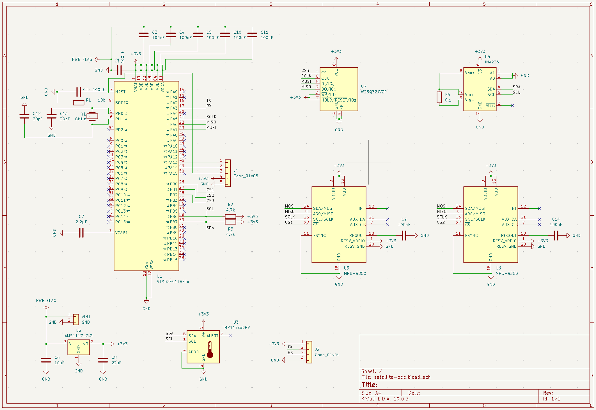
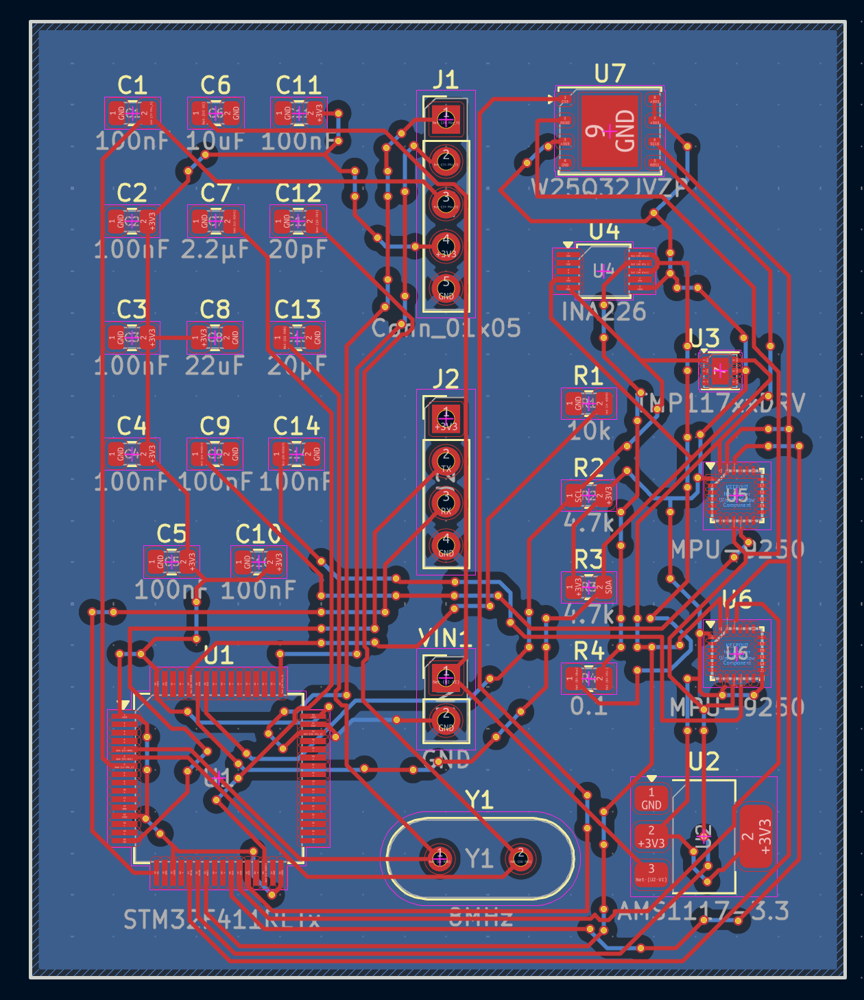
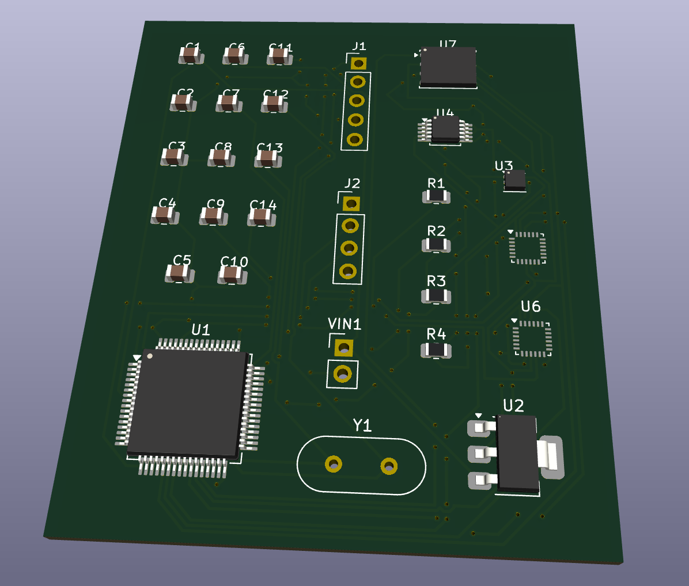

# Satellite Onboard Computer

This is a small computer for a satellite that I designed and programmed. It reads sensors, checks that everything is working, saves faults to flash memory, and sends data to a Python program on a PC.

Made with KiCad, STM32, C, Python, I2C, SPI, UART and CRC-16.







## What's on the board

- STM32F411 microcontroller
- Two MPU-9250 motion sensors (two so one can back up the other)
- TMP117 temperature sensor
- INA226 voltage and current monitor
- W25Q32 flash memory for saving faults
- AMS1117 3.3V regulator

The board is 2 layers and passes the KiCad ERC and DRC checks.

## How the firmware works

The firmware is written in C and has four states:

- **BOOT**: sets up the hardware
- **SELF_TEST**: checks that every sensor and the flash respond
- **NOMINAL**: normal operation, reads sensors and sends data 10 times a second
- **SAFE_MODE**: something went wrong, so the fault is saved to flash and the computer waits for the ground station

If a sensor fails, the two motion sensors disagree, or a value goes out of range, it switches to SAFE_MODE and saves an error code to flash. A hardware watchdog resets the chip if the firmware freezes.

## Talking to the computer

The board sends data over UART at 115200 baud. Each message has a CRC-16 so the PC can tell if it got corrupted. The ground station can also send commands (ping, safe mode, recover, read the fault log, clear the log, reboot) and gets back an ACK or NACK.

To run the ground station:

```
pip install pyserial
python ground_station/ground_station.py COM3
```

Change COM3 to whatever port your USB-serial adapter uses. Type `help` to see the commands.

## Folders

- `firmware/src`: the C code
- `ground_station`: the Python program
- `hardware`: KiCad files

## Building the firmware

I only included the source files. To build it, make an STM32CubeIDE project for the STM32F411RE and add `firmware/src` to it.